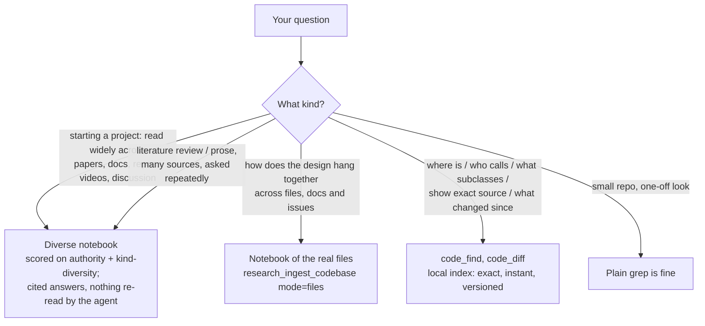
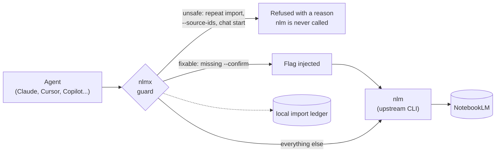
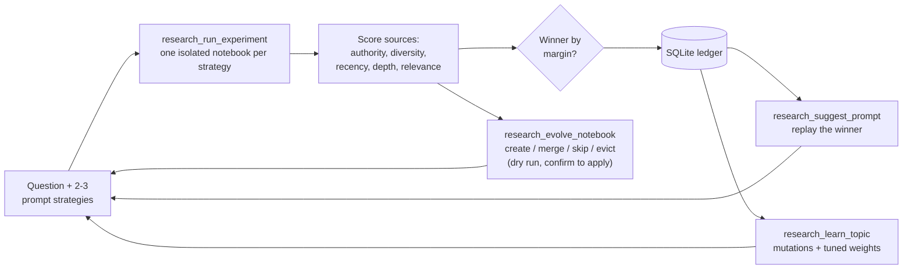
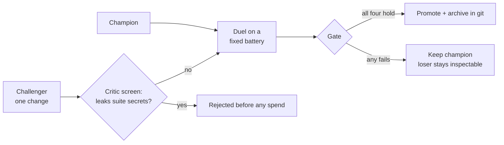

# NoteLab 🧪

**Give your coding agent a research lab and a memory: questions it answers exactly, sources it can't silently corrupt, and every version of your code kept.**

[](https://github.com/werister/notelab/actions/workflows/tests.yml)


**Starting a project well means reading widely first** — the papers, the official docs, the
repos people actually build on, the step-by-step videos, and the honest community threads about
what goes wrong. NoteLab turns that scattered reading into one scored, queryable research library,
then helps your agent turn it into a concrete setup: a plan, mock data, tests, and code snippets.

**What NoteLab gives your agent:**

| | What it gives your agent | Why it matters |
|---|---|---|
| 🧪 **A diverse research library** | Pulls papers, docs, repos, videos and discussion into one notebook; scores the set on authority, **kind-diversity**, recency, depth and relevance | A good starting library is a *mix of kinds*, not ten links to the same kind of page. The score rewards that mix, so "did I read widely enough?" becomes a number — and the agent asks the notebook questions instead of re-reading PDFs. |
| 🧭 **A path from reading to building** | A/B-tests research prompts, remembers the winner per topic, prunes stale sources, and feeds the diverse notebook into a scaffolded setup | Research stops being "this felt better" and becomes something you can compare and reuse — then becomes a spec, step-by-step plan, mock data and snippets you can build on. |
| 🛡️ **A guard** (`nlmx`) | Refuses the NotebookLM behaviours that silently corrupt a research library | A repeated import duplicates every source behind the same green checkmark. Live agents from two model families were pointed at the guard and stopped 6/6. |

Most "NotebookLM MCP" tools are a remote control: create notebook, add source, query. NoteLab is the
layer above it — it judges *whether the research is any good* and helps you act on it. A local, versioned
[code index](#also-included-a-versioned-code-index) is included for exact code lookups, but the heart of
NoteLab is the research library.

## Try it in 60 seconds (no NotebookLM account)

```bash
git clone https://github.com/werister/notelab && cd notelab
pip install -e ".[dev]"
scripts/verify.sh            # offline tests + demo + guard refusals, one checklist
```

```
NoteLab verify
  PASS  engine imports (stdlib only)
  PASS  offline test suite
  PASS  self-improving loop demo
  PASS  code index: exact lookup + versions
  PASS  guard refuses --source-ids
  PASS  guard refuses chat start
  PASS  skills present with frontmatter
All good.
```

Then install the skills into your agent, or paste this to Claude Code and let it do it:

> Install NoteLab's skills: run `git clone https://github.com/werister/notelab ~/notelab && ~/notelab/scripts/install-skills.sh claude --with-guard && ~/notelab/scripts/verify.sh`, then tell me which of the four skills (nlm-skill, research-loop, skill-evolution, code-questions) fits what I do and give me one prompt to try it.

## Build something with it (starter recipes)

Each recipe is a prompt you paste into your agent after installing the skills. Pick the one that
matches what you are trying to do.

**1. "I'm starting a project — read widely first and tell me if the library is any good" (needs `nlm`)**
> Use the research-loop skill with the `project_kickstart` weights. Research `<the thing I want to build>`, pulling papers, official docs, example repos, a step-by-step video and community discussion. Score the notebook and tell me whether the *mix of source kinds* is diverse enough or lopsided.

You get a composite score plus a `type_mix` (how many papers / docs / repos / videos / discussions) and a `type_diversity`
number, so "did I read widely enough?" is answerable, not a feeling. A library that's all papers scores *lower* on
diversity than a genuine mix — by design.

**2. "Turn what I found into a concrete setup" (needs `nlm`)**
> From the winning notebook, draft how to set this up step by step: a short spec, the directory layout, mock data, a couple of tests, and the key code snippets — each grounded in a cited source.

The notebook holds the diverse sources; the agent synthesizes them into something you can build on, with citations back
to the paper/doc/repo/video/thread each step came from.

**3. "Do a literature review I can keep questioning" (needs `nlm`)**
> Use the research-loop skill. Compare a broad and an authoritative-sources prompt on `<your question>`. Tell me which found better sources and by how much, then answer my follow-ups from the winning notebook.

You get a winner, a margin and per-signal scores, then cited answers from a notebook, not a pile of PDFs in your agent's context.

**4. "Stop my agent from wrecking my notebooks" (needs `nlm`)**
```bash
scripts/install-skills.sh claude --with-guard
```
> Using nlm-skill, import the research results into notebook `<id>`. Then do it again.

The second import is refused, with a reason, instead of doubling your sources.

**5. "Understand a library before I build on it" (no account needed)**
```bash
python3 -m notelab.codeindex index ~/code/some-lib      # once; version = git commit
```
> Use the code-questions skill. Where is `<function>` defined, who calls it, and what subclasses `<Class>`? Show the exact source.

You get `repo@commit/path:line` answers with real code, in milliseconds — see [the code index](#also-included-a-versioned-code-index).

## Which engine answers which question



## What goes wrong without it

These are observed failures, each reproduced on isolated notebooks and checked against
ground truth (`nlm source list`), not trusted at face value. Evidence in
[docs/NLMX.md](docs/NLMX.md).

| # | The failure | What the agent sees | What NoteLab does |
|---|---|---|---|
| 1 | `research import` run twice **duplicates every source** | The same "✓ Imported N sources" both times | `nlmx` keeps a local ledger and refuses the repeat unless `--force` |
| 2 | `--source-ids` **deselects every source** instead of scoping to one | `sources_used: []` | `nlmx` refuses and names the working alternative |
| 3 | Generation commands without `--confirm` silently no-op | Nothing | `nlmx` injects the flag |
| 4 | `chat start` opens a REPL an agent can't drive | A hang | `nlmx` refuses and points to one-shot `query` |
| 5 | Research prompts are tuned by vibes | "This one felt better" | A/B on measured **source quality**, winner stored in a ledger |
| 6 | Notebooks fill with duplicates and stale sources | Quality decays quietly | `research_evolve_notebook` plans create / merge / skip / evict (dry run first) |
| 7 | Skills and prompts get edited and hoped about | No evidence either way | Champion vs challenger on a fixed battery, gated on margin, held-out and a green tree |

## Why this is a good place to start

If you are new to building with agents, "research" is where most people start and where most burn time and
money: ask an agent about a topic, and it opens a few pages, downloads PDFs, reads them into its own context and
summarizes. It works once, costs a lot, can't show its work, and you can't tell whether the second attempt was
any better. NoteLab gives a beginner four things that normally take months of mistakes to learn:

- **A guard rail.** The agent can't quietly wreck your library with a repeated command. A refusal explains itself, so you learn what went wrong instead of debugging a silent failure.
- **A scoreboard.** Every run gets a number that decomposes into five readable signals (authority, diversity, recency, depth, relevance). You build the habit of measuring a prompt instead of trusting a feeling, which is the core skill of working with agents.
- **Learning material, not just links.** One question pulls in explainer videos, lectures, blog walkthroughs, Wikipedia and the original papers together (below), so you can ask "explain it simply" and "show me the primary source" of the same notebook.
- **Small, readable pieces.** The engine is plain Python with no dependencies, the tests run offline, and `scripts/verify.sh` tells you in seconds whether your setup works. You can read the whole thing.

## Better than just letting an agent research

| Letting an agent research on its own | With NoteLab |
|---|---|
| It reads each page and PDF inside its own context, again for every follow-up | NotebookLM retrieves and indexes the sources outside the agent; follow-ups are questions to the notebook and return cited answers |
| "Which sources are good?" is the model's opinion, different every time | A deterministic scorer runs locally over the source list: **zero model tokens**, same input gives the same score, and every number shows its parts |
| A prompt is "better" because it felt better | Prompts are A/B-tested on measured source quality, the winner is stored in a ledger and replayed next time |
| Duplicates and stale sources pile up unnoticed | `research_evolve_notebook` plans create / merge / skip / evict, dry run first |
| A repeated import silently doubles your sources | `nlmx` refuses it, with a reason |
| Prior work is forgotten next session | Experiments, winners, per-topic strategy and every indexed code version are stored locally and stay queryable |

There is no token-savings percentage here, on purpose: the saving is structural (the agent doesn't ingest the
documents), and it depends on your agent and how many sources you have. Run the same question both ways and
compare your own usage.

## What it finds: from explainer videos to research papers

Deep Research doesn't just return links to the same kind of page. For the question *"how transformers attention
works: explainer videos, lectures, blog posts and the original papers"*, **one fast run** (about 100 seconds)
returned this mix, which we then scored with `research_score_notebook`:

| Kind | What came back |
|---|---|
| 🎬 Video lectures | 3Blue1Brown, "Attention in transformers, step-by-step"; MIT 6.S191 on RNNs, transformers and attention |
| 📄 Papers and course notes | "Formal Algorithms for Transformers" (arXiv), "Neural Machine Translation by Jointly Learning to Align and Translate" (ICLR), Stanford CS224n self-attention notes |
| ✍️ Walkthroughs | The Illustrated Transformer, Transformers from scratch, Raschka's self-attention tutorial, a scaled dot-product explainer |
| 📚 Orientation | Wikipedia, "Attention Is All You Need" |

NoteLab scored that set **~0.63 overall, with a kind mix of 2 videos / 2 papers / 1 reference / 5
walkthroughs** across 10 domains. The scorer gives arXiv and Wikipedia high authority (0.95) and treats
video domains and personal blogs as neutral (0.5) rather than pretending to rank them — videos earn their
place through relevance and the kind-diversity signal. (A set this blog-heavy scores *lower* on
kind-diversity than a more balanced spread would, which is the signal doing its job: it is telling you to
pull in a repo or a discussion thread, not just more walkthroughs.)

**Videos need a repair step.** Deep Research imports a YouTube link as an ordinary web page, which is often a
*"Sign in to confirm you're not a bot"* wall rather than the transcript — the notebook looks full but knows nothing
about the video. `research_fix_videos(notebook_id)` lists every YouTube source, flags blocked copies, and with
`apply=true` re-adds them natively so the real transcript (tens of thousands of characters) is used. It only adds
sources; deleting the blocked copies is a separate `remove_junk=true` you must ask for. Run it after any research
import that touched videos.

### Where it fits, and where it doesn't

- **Papers, docs, videos and prose you will question repeatedly:** the notebook route.

#### Also included: a versioned code index

A grep-capable agent already answers small code questions well, so for a quick look at one small repo, use grep.
Where the code index earns its place is exactness and *history* — it's a supporting feature, not the headline:
  1. **Exact, targeted lookups you can trust**: `code_find` returns the real source with
     `repo@version/path:line` for *where is X defined*, *who calls X* (AST-accurate in Python),
     *what subclasses X* and ranked text search. Indexed locally in under a second, no model tokens.
  2. **Versions that are never forgotten.** Every `code_index` run keeps a snapshot (labelled by git
     commit), deduplicated by content. Ask about any past version, or `code_diff` two of them:
     on click 8.1.7 vs main it listed 1 file added, 140 functions added, 78 removed and 293 changed
     in one call, and each version's `Context.forward` stayed queryable with no checkout.
  3. **Many repos in one place**, plus an optional notebook (`research_ingest_codebase(mode="files")`)
     for conceptual, cross-document questions that grep can't answer.

  `research_ingest_codebase`'s default `digest` mode holds only a structure summary, not source; use `mode="files"`
  when you want the notebook to answer detail questions.

## How it works

### 1. The guard: where `nlmx` sits



### 2. The loop: how each run improves the next



Scores measure **source data quality, not answer quality**. A 0.9 arm found good sources;
you still read them. A margin under 0.05 is a tie and the tool says so.

### 3. The gate: how a skill earns promotion



The four conditions, in code at `src/notelab/research/skill_evolve.py`:
beats `max(margin, noise floor)`; prompt growth paid for by gain; no held-out task
regresses; the tree is green on both runs.

## Pick your path

| I want to… | Run | Needs |
|---|---|---|
| See the loop work | `python examples/self_improving_loop.py` | Python only |
| Ask exact questions about code, across versions | `python3 -m notelab.codeindex index <repo>` then `find` / `diff` | Python only |
| Check my install | `scripts/verify.sh` | Python only |
| Use the skills in my agent | `scripts/install-skills.sh claude` | Claude Code or Cursor |
| Run the live research tools | [Go live](#go-live-real-notebooklm-research) | `nlm` account login |
| Prove a guard stops a real agent | `python -m notelab.research.guard_evals ...` | An agent CLI + a test notebook |
| Improve a skill with evidence | `skills/skill-evolution/scripts/evolve.py --init` | An agent CLI |

## The skills

Four skills in `skills/`. Install all of them: `scripts/install-skills.sh <claude|cursor|all> [--link] [--with-guard]`
(`--link` symlinks so `git pull` updates them).

<details open><summary><b>research-loop</b>: research <i>through</i> NoteLab</summary>

Use it when the job is "research X and get better at it". It drives the research MCP tools
through the loop above and carries the rules: evolve is dry-run first, guard work goes
through `nlmx`, record wins in the ledger instead of remembering them.

- **Try:** *"Use the research-loop skill. Run an experiment on 'what is the state of quantum error correction' with two prompt strategies and tell me which won and by how much."*
- **You should see:** a `winner`, a `margin_over_runner_up`, and an experiment id in `research_history`.
- **Worked flows:** [loop cookbook](skills/research-loop/references/loop-cookbook.md): improve a prompt, curate a notebook, prove a guard.
</details>

<details><summary><b>skill-evolution</b>: make a prompt or skill measurably better</summary>

Champion/challenger duels on a fixed battery. Promotes only through the gate above.
Includes a guided setup and an effort dial (`smoke` / `standard` / `deep`) that prints
the live-run budget before spending anything.

- **Try:** `python skills/skill-evolution/scripts/evolve.py --init`
- **You should see:** a walkthrough ending in the exact duel command and its run count.
- **Protocol:** [SKILL.md](skills/skill-evolution/SKILL.md).
</details>

<details><summary><b>code-questions</b>: targeted, versioned code lookups</summary>

Index a repo once, then ask exact questions: where is X defined (with its exact source), who calls
X, what subclasses X, ranked text search, and what changed between two versions. Local and
instant, no NotebookLM account needed.

- **Try:** `python3 -m notelab.codeindex index . && python3 -m notelab.codeindex find main --kind def`
- **You should see:** `<repo>@<commit>/<path>:<line>  [function main]` followed by the real source.
- **Details:** [SKILL.md](skills/code-questions/SKILL.md).
</details>

<details><summary><b>nlm-skill</b>: operate NotebookLM safely</summary>

Upstream's `nlm` skill with one added section that routes agents through `nlmx` and
explains why, backed by the evidence table above.

- **Try:** *"Using nlm-skill, list my notebooks."*
- **You should see:** the agent calls `nlmx`, not bare `nlm`.
</details>

## Install

<details><summary><b>Claude Code</b></summary>

```bash
scripts/install-skills.sh claude --with-guard
```
</details>

<details><summary><b>Cursor</b></summary>

```bash
scripts/install-skills.sh cursor --with-guard
```
</details>

<details><summary><b>GitHub Copilot CLI</b></summary>

```bash
copilot skill add skills/research-loop
copilot skill add skills/skill-evolution
copilot skill add skills/nlm-skill
copilot skill add skills/code-questions
```
</details>

<details><summary><b>MCP server only (any MCP client)</b></summary>

```bash
pip install -e .          # stdlib-only: no third-party dependencies
```
```json
{ "mcpServers": { "nlm-research": { "command": "nlm-research-mcp" } } }
```
Prefer the official SDK? `pip install -e ".[mcp]"` and run `nlm-research-mcp --sdk`.
</details>

### Go live: real NotebookLM research

The tools that touch NotebookLM call `nlmx`, which wraps the upstream
[`nlm`](https://github.com/jacob-bd/notebooklm-mcp-cli). `nlm` owns authentication, so
install and log in to it first. Everything else (scorer, A/B, planner, evals, catalog, MCP
layer) runs without it, and tools return a clear error rather than failing to load.

```bash
pipx install notebooklm-mcp-cli      # or: uv tool install notebooklm-mcp-cli
nlm login && nlm login --check       # browser login; cookies last weeks
scripts/install-skills.sh claude --with-guard
scripts/verify.sh                    # now also confirms nlm is on PATH
```

## Evaluations

Claims here are backed by checks you can rerun. Full detail and commands: [docs/EVALUATIONS.md](docs/EVALUATIONS.md).

| What is checked | How | Result |
|---|---|---|
| The guard stops a **real agent**, not just a unit test | Live agents from two model families are pointed at read-only scenarios (`--source-ids`, `chat start`, missing notebook). `nlmx` refuses before `nlm` is called. | **6 / 6** (opencode 3/3, claude 3/3), sweep of 2026-10-07 |
| Honest scoring | Only substantive refusal markers count; runs that couldn't produce a signal (quota, usage limit, no shell) are reported as environment errors, never as passes or failures | by construction |
| Skills improve only when they **measurably** win | Champion vs challenger on a fixed battery, gated on margin over a bootstrapped noise floor, a cost rule, no held-out regression, and a green tree | The recorded duels **held** (challenger tied the champion, so no promotion): the gate refuses unearned wins |
| Research strategies improving or regressing | OLS-slope trend with the raw series (`research_eval_skill`) | Demo: `improving, +0.081/run` |
| Source scoring is auditable | Every composite decomposes into its five signals; weights are config | See any `research_score_notebook` output |
| Code index is exact and versioned | Tests for verbatim source, AST callers and subclasses, text search, kept versions, diffs, non-Python symbols | In the offline suite |
| Video repair works on real notebooks | Live: blocked YouTube copies detected, native copies added, a lecture answered from its transcript | Checked on a real notebook (see above) |
| The whole package | 353 offline tests pass, 3 optional/env-gated tests skip without keys; CI on Python 3.10, 3.12, 3.13; `scripts/verify.sh` is the same checklist on your machine | green |

**Design choices that limit blast radius**

- Source eviction is a plan; applying it is confirm-gated. No silent delete path exists, and `research_fix_videos` never deletes unless asked.
- Scores decompose into their five signals. No black-box verdict.
- The engine imports only the standard library, so there is no dependency supply chain to audit.
- Skill duels reject challengers that contain suite secrets *before* any spend.

**What it does not do.** `nlmx` guards the four behaviours above, not all of NotebookLM; anything else passes
straight through to `nlm`. Source-quality scores say nothing about whether an answer is correct. It does not
handle your Google credentials: `nlm` does. Report vulnerabilities privately: [SECURITY.md](SECURITY.md).

## MCP tools (19)

<details><summary>Full tool table</summary>

| Tool | What it does |
|---|---|
| `research_run_experiment(question, strategies, weights?)` | A/B several prompt strategies; score each run's sources; rank; record to ledger |
| `research_score_notebook(notebook_id, question?, weights?, semantic_expansions?)` | Score the data quality of an existing notebook's sources; returns per-signal scores plus a `type_mix` and `type_diversity` (how many papers/docs/repos/videos/discussions). `weights` takes a preset name (`project_kickstart`, `lit_review`, `news`, `docs`, `balanced`) or a dict; `semantic_expansions` needs `MISTRAL_API_KEY` |
| `research_history(experiment_id?, limit?)` | Browse the experiment ledger, or fetch one full result |
| `research_suggest_prompt(question)` | Reuse the winning prompt from a prior experiment on the same question |
| `research_evolve_notebook(notebook_id, question?, keep_budget?, quality_floor?, apply?)` | Plan create / merge / skip / evict over a notebook's sources; evictions stay behind the confirm gate |
| `research_assess(notebook_id, question?, mode?, weights?, use_laya?, semantic_expansions?)` | `fast` good/thin/bloated verdict + coverage gaps, or `deep` ablation + redundant pairs + greedy prune |
| `research_eval_skill(strategy_name)` | Is a strategy improving or regressing? OLS-slope trend + raw series |
| `research_adversarial_run(prompt, runners?, timeout?)` | Run a prompt through installed agent CLIs; missing ones skipped, not failed |
| `catalog_sync(notebook_ids?)` | Index notebooks + sources into the local catalog |
| `catalog_search(query, limit?)` | Full-text search: "what do we already know about X" before researching again |
| `research_learn_topic(question, explore?)` | Turn a topic's experiment history into prompt mutations + a tuned weight profile |
| `research_spar(question, prompt, families?)` | Run one prompt through several model-family CLIs over a shared corpus; score and attribute each |
| `research_family_leaderboard()` | Which model family finds the best sources for which kind of question |
| `research_ingest_codebase(repo, notebook_id?, title?, max_files?, mode?, max_sources?)` | Add a repo to a notebook: `digest` (structure summary, default) or `files` (the real source, bundled) |
| `code_index(repo, name?, version?)` | Index a repo locally as a kept, versioned snapshot (default label: git commit) |
| `code_find(query, kind?, repo?, version?, limit?)` | Exact, instant lookup: `def` (with source), `callers`, `subclasses`, `text`, `any` |
| `research_fix_videos(notebook_id, apply?, remove_junk?)` | Repair YouTube sources imported as bot-wall pages: plan, or re-add them natively so the real transcript is used |
| `code_versions(repo?)` | List every kept version |
| `code_diff(repo, old, new)` | Files and functions added / removed / changed between two versions |

Source-quality weights are config, not code: pass a preset (`project_kickstart`, `news`,
`lit_review`, `docs`, `balanced`) or your own vector. See [docs/CONFIG.md](docs/CONFIG.md).
</details>

<details><summary>What the demo prints</summary>

```
1. A/B — score prompt strategies on SOURCE data quality
   winner: authoritative  (score 0.827, margin 0.6748)
     authoritative   quality=0.827    n_sources=3
     broad           quality=0.1522   n_sources=2

2. Ledger — record it, then reuse the winning prompt for a repeat question
   suggested prompt next time: 'find authoritative primary quantum sources'

3. Evolve — curate the notebook's sources over two cycles
   -- cycle 1 --  merge dupe | skip new_weak (0.13 < floor 0.35) | create new_good
   -- cycle 2 --  evict stale (weak for 2 consecutive cycles)

4. Evals — is 'authoritative' improving or regressing?
   trend: improving  (+0.081/run)   scores: [0.34, 0.41, 0.49, 0.58, 0.66]
```
</details>

## Docs

[DESIGN](docs/DESIGN.md) architecture and quality model · [NLMX](docs/NLMX.md) the guard and its evidence ·
[CONFIG](docs/CONFIG.md) weights · [FIELD-NOTES](docs/FIELD-NOTES.md) · [RESULTS](docs/RESULTS-2026-09-23.md) ·
[EVALUATIONS](docs/EVALUATIONS.md) what is checked and how to rerun it ·
[EVAL REPORT](docs/EVAL-REPORT-2026-10-08.md) a full hands-on eval pass ·
[CHANGELOG](CHANGELOG.md) · [CONTRIBUTING](CONTRIBUTING.md) · [SCOPE](SCOPE.md)

## Contributing

Bug reports with an observed failure are the most useful kind: what you ran, what happened,
what you expected. See [SCOPE.md](SCOPE.md) for the bar and [CONTRIBUTING.md](CONTRIBUTING.md) for setup.

MIT licensed.
