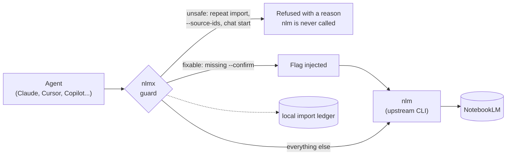
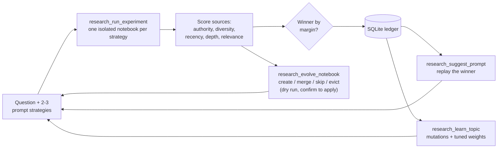
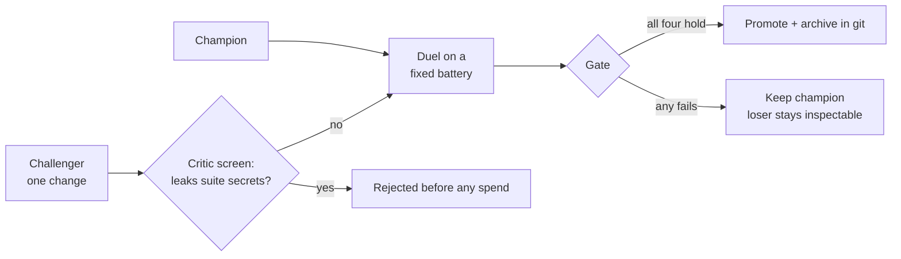

# NoteLab 🧪

**Research that gets better every run, on a floor that won't silently corrupt your sources.**

[](https://github.com/werister/notelab/actions/workflows/tests.yml)


*20 seconds of real output: a guard refusing a corrupting re-import, the self-improving
loop picking a winner, the suite green, live agents stopped 6/6.
[Full video with sound](brag-output/brag.mp4).*

Most "NotebookLM MCP" tools are a remote control: create notebook, add source, query.
NoteLab is the layer above. It treats **deep research as an experiment**: it scores the
quality of the sources each run pulls in, A/B-tests the prompts that found them, keeps
the winners, prunes stale sources, and remembers what worked per topic. Underneath sits
a guard (`nlmx`) that stops the agent from silently duplicating or losing your sources.

## Try it in 60 seconds (no NotebookLM account)

```bash
git clone https://github.com/werister/notelab && cd notelab
pip install -e ".[dev]"
scripts/verify.sh            # offline tests + demo + guard refusals, one checklist
```

```
NoteLab verify
  PASS  engine imports (stdlib only)
  PASS  offline test suite
  PASS  self-improving loop demo
  PASS  guard refuses --source-ids
  PASS  guard refuses chat start
  PASS  skills present with frontmatter
All good.
```

Then install the skills into your agent, or paste this to Claude Code and let it do it:

> Install NoteLab's skills: run `git clone https://github.com/werister/notelab ~/notelab && ~/notelab/scripts/install-skills.sh claude --with-guard && ~/notelab/scripts/verify.sh`, then tell me which of the three skills (nlm-skill, research-loop, skill-evolution) fits what I do and give me one prompt to try it.

## What goes wrong without it

These are observed failures, each reproduced on isolated notebooks and checked against
ground truth (`nlm source list`), not trusted at face value. Evidence in
[docs/NLMX.md](docs/NLMX.md).

| # | The failure | What the agent sees | What NoteLab does |
|---|---|---|---|
| 1 | `research import` run twice **duplicates every source** | The same "✓ Imported N sources" both times | `nlmx` keeps a local ledger and refuses the repeat unless `--force` |
| 2 | `--source-ids` **deselects every source** instead of scoping to one | `sources_used: []` | `nlmx` refuses and names the working alternative |
| 3 | Generation commands without `--confirm` silently no-op | Nothing | `nlmx` injects the flag |
| 4 | `chat start` opens a REPL an agent can't drive | A hang | `nlmx` refuses and points to one-shot `query` |
| 5 | Research prompts are tuned by vibes | "This one felt better" | A/B on measured **source quality**, winner stored in a ledger |
| 6 | Notebooks fill with duplicates and stale sources | Quality decays quietly | `research_evolve_notebook` plans create / merge / skip / evict (dry run first) |
| 7 | Skills and prompts get edited and hoped about | No evidence either way | Champion vs challenger on a fixed battery, gated on margin, held-out and a green tree |

## Why this is a good place to start

If you are new to coding with agents, "research" is where most people start and where
most of them burn time and money: ask an agent about a topic, and it opens ten pages,
downloads PDFs, reads them into its own context, and summarizes. It works once, costs a
lot, and you can't tell whether the second attempt was any better.

NoteLab gives you three things a beginner usually has to learn the hard way:

- **A guard rail.** The agent can't quietly wreck your library with a repeated command. A refusal explains itself, so you learn what went wrong instead of debugging a silent failure.
- **A scoreboard.** Every run gets a number you can read and compare. You build the habit of measuring a prompt instead of trusting a feeling, which is the core skill of working with agents.
- **Small, readable pieces.** The engine is plain Python with no dependencies, the tests run offline, and `scripts/verify.sh` tells you in seconds whether your setup works. You can read the whole thing.

## Give your agent the internet (without giving it your context window)

NotebookLM's Deep Research does the web work **on Google's side**: it searches, collects
sources and imports them into a notebook. Your agent's model never downloads or reads them.
NoteLab drives that loop and measures it.

```
You → agent → research_run_experiment("your question", strategies)
              └─ for each strategy, via nlmx:  research run → web search → sources imported into a notebook
              └─ NoteLab scores each source set locally (no model call)
              └─ agent receives: winner, margin, per-signal scores, notebook ids
You → agent → "answer from the winning notebook" → one grounded, cited answer
```

To use it:

1. Install and log in to `nlm` ([Go live](#go-live-real-notebooklm-research)). That login is the only internet credential involved, and it stays with `nlm`.
2. Install the skills (`scripts/install-skills.sh claude --with-guard`) so the agent knows the loop and the rules.
3. Ask in plain language, for example: *"Use the research-loop skill. Compare a broad prompt and an authoritative-sources prompt on 'current treatment guidelines for X', and tell me which found better sources."*
4. Read the `winner` and the per-signal scores, open the best sources yourself, and ask follow-ups against that notebook.

### Why it saves tokens

The usual alternative is an agent that fetches 70 PDFs, pushes them through its own
context, and summarizes them, again for every follow-up question. NoteLab avoids that in
three places:

| Step | The usual way | With NoteLab |
|---|---|---|
| Finding and reading sources | The agent downloads and reads each document in its own context | NotebookLM retrieves and indexes them outside the agent |
| Judging which sources are good | The model reads them and gives an opinion | A deterministic scorer run locally over the source list (domain, date, length, term overlap): **zero model tokens**, same input gives the same score |
| Follow-up questions | Re-read or re-summarize the documents | Ask the notebook; the agent receives a cited answer, not the documents |
| Trying the same topic again | Start from scratch | `research_suggest_prompt` replays the stored winner |

Measured, once: with the same 29 papers and 5 specific questions, Claude's CLI cost
**$0.57 reading the PDFs itself** (43 turns, ~659k input tokens) versus **$0.25 asking a
NotebookLM notebook through NoteLab** (8 turns, ~191k), and the notebook route is slower
(247 s vs 106 s). The PDF reader also only read page one of each paper. This is a single
trial on 29 papers, not 70, correctness was not graded, and most other CLIs we tried were
out of quota. Method and every caveat: [docs/BENCHMARK.md](docs/BENCHMARK.md). NotebookLM's own
limits (sources per notebook, daily usage) still apply.

## How it works

### 1. The guard: where `nlmx` sits



### 2. The loop: how each run improves the next



Scores measure **source data quality, not answer quality**. A 0.9 arm found good sources;
you still read them. A margin under 0.05 is a tie and the tool says so.

### 3. The gate: how a skill earns promotion



The four conditions, in code at `src/notelab/research/skill_evolve.py`:
beats `max(margin, noise floor)`; prompt growth paid for by gain; no held-out task
regresses; the tree is green on both runs.

## Pick your path

| I want to… | Run | Needs |
|---|---|---|
| See the loop work | `python examples/self_improving_loop.py` | Python only |
| Check my install | `scripts/verify.sh` | Python only |
| Use the skills in my agent | `scripts/install-skills.sh claude` | Claude Code or Cursor |
| Run the live research tools | [Go live](#go-live-real-notebooklm-research) | `nlm` account login |
| Prove a guard stops a real agent | `python -m notelab.research.guard_evals ...` | An agent CLI + a test notebook |
| Improve a skill with evidence | `skills/skill-evolution/scripts/evolve.py --init` | An agent CLI |

## The skills

Three skills in `skills/`. Install all of them: `scripts/install-skills.sh <claude|cursor|all> [--link] [--with-guard]`
(`--link` symlinks so `git pull` updates them).

<details open><summary><b>research-loop</b>: research <i>through</i> NoteLab</summary>

Use it when the job is "research X and get better at it". It drives the 14 MCP tools
through the loop above and carries the rules: evolve is dry-run first, guard work goes
through `nlmx`, record wins in the ledger instead of remembering them.

- **Try:** *"Use the research-loop skill. Run an experiment on 'what is the state of quantum error correction' with two prompt strategies and tell me which won and by how much."*
- **You should see:** a `winner`, a `margin_over_runner_up`, and an experiment id in `research_history`.
- **Worked flows:** [loop cookbook](skills/research-loop/references/loop-cookbook.md): improve a prompt, curate a notebook, prove a guard.
</details>

<details><summary><b>skill-evolution</b>: make a prompt or skill measurably better</summary>

Champion/challenger duels on a fixed battery. Promotes only through the gate above.
Includes a guided setup and an effort dial (`smoke` / `standard` / `deep`) that prints
the live-run budget before spending anything.

- **Try:** `python skills/skill-evolution/scripts/evolve.py --init`
- **You should see:** a walkthrough ending in the exact duel command and its run count.
- **Protocol:** [SKILL.md](skills/skill-evolution/SKILL.md).
</details>

<details><summary><b>nlm-skill</b>: operate NotebookLM safely</summary>

Upstream's `nlm` skill with one added section that routes agents through `nlmx` and
explains why, backed by the evidence table above.

- **Try:** *"Using nlm-skill, list my notebooks."*
- **You should see:** the agent calls `nlmx`, not bare `nlm`.
</details>

## Install

<details><summary><b>Claude Code</b></summary>

```bash
scripts/install-skills.sh claude --with-guard
```
</details>

<details><summary><b>Cursor</b></summary>

```bash
scripts/install-skills.sh cursor --with-guard
```
</details>

<details><summary><b>GitHub Copilot CLI</b></summary>

```bash
copilot skill add skills/research-loop
copilot skill add skills/skill-evolution
copilot skill add skills/nlm-skill
```
</details>

<details><summary><b>MCP server only (any MCP client)</b></summary>

```bash
pip install -e .          # stdlib-only: no third-party dependencies
```
```json
{ "mcpServers": { "nlm-research": { "command": "nlm-research-mcp" } } }
```
Prefer the official SDK? `pip install -e ".[mcp]"` and run `nlm-research-mcp --sdk`.
</details>

### Go live: real NotebookLM research

The tools that touch NotebookLM call `nlmx`, which wraps the upstream
[`nlm`](https://github.com/jacob-bd/notebooklm-mcp-cli). `nlm` owns authentication, so
install and log in to it first. Everything else (scorer, A/B, planner, evals, catalog, MCP
layer) runs without it, and tools return a clear error rather than failing to load.

```bash
pipx install notebooklm-mcp-cli      # or: uv tool install notebooklm-mcp-cli
nlm login && nlm login --check       # browser login; cookies last weeks
scripts/install-skills.sh claude --with-guard
scripts/verify.sh                    # now also confirms nlm is on PATH
```

## Reliability and security

**Tests.** Offline, no account needed: 334 pass, 2 optional live tests skip without keys.
CI runs on Python 3.10, 3.12 and 3.13. `scripts/verify.sh` is the same checklist on your machine.

**Live proof.** Unit tests prove the guard logic. The eval harness proves a real agent
reasoning for itself gets stopped. Every scenario is read-only: `nlmx` refuses before `nlm` is called.
Latest sweep (2026-10-07):

| runner | `--source-ids` refusal | `chat start` refusal | missing-notebook fail-fast |
|---|---|---|---|
| opencode | ✅ | ✅ | ✅ |
| claude | ✅ | ✅ | ✅ |

6/6 across two model families. Only substantive refusal markers count, so a bare command
echo doesn't pass. Runs that can't produce a signal (quota, usage limit, no shell) are
reported as environment errors, never as passes or failures.

**Design choices that limit blast radius**

- Source eviction is a plan; applying it is confirm-gated. No silent delete path exists.
- Scores decompose into their five signals. No black-box verdict.
- The engine imports only the standard library, so there is no dependency supply chain to audit.
- Skill duels reject challengers that contain suite secrets *before* any spend.

**What it does not do.** `nlmx` guards the four behaviours above, not all of NotebookLM.
Anything else passes straight through to `nlm`. Source-quality scores say nothing about
whether an answer is correct. It does not handle your Google credentials: `nlm` does.

**Publishing hygiene.** Every publish is audited against a written checklist (secrets,
personal data, identity, media, fixtures): [docs/SECURITY-LOG.md](docs/SECURITY-LOG.md).
Report vulnerabilities privately: [SECURITY.md](SECURITY.md).

## MCP tools (14)

<details><summary>Full tool table</summary>

| Tool | What it does |
|---|---|
| `research_run_experiment(question, strategies, weights?)` | A/B several prompt strategies; score each run's sources; rank; record to ledger |
| `research_score_notebook(notebook_id, question?, weights?, semantic_expansions?)` | Score the data quality of an existing notebook's sources (`semantic_expansions` needs `MISTRAL_API_KEY`) |
| `research_history(experiment_id?, limit?)` | Browse the experiment ledger, or fetch one full result |
| `research_suggest_prompt(question)` | Reuse the winning prompt from a prior experiment on the same question |
| `research_evolve_notebook(notebook_id, question?, keep_budget?, quality_floor?, apply?)` | Plan create / merge / skip / evict over a notebook's sources; evictions stay behind the confirm gate |
| `research_assess(notebook_id, question?, mode?, weights?, use_laya?, semantic_expansions?)` | `fast` good/thin/bloated verdict + coverage gaps, or `deep` ablation + redundant pairs + greedy prune |
| `research_eval_skill(strategy_name)` | Is a strategy improving or regressing? OLS-slope trend + raw series |
| `research_adversarial_run(prompt, runners?, timeout?)` | Run a prompt through installed agent CLIs; missing ones skipped, not failed |
| `catalog_sync(notebook_ids?)` | Index notebooks + sources into the local catalog |
| `catalog_search(query, limit?)` | Full-text search: "what do we already know about X" before researching again |
| `research_learn_topic(question, explore?)` | Turn a topic's experiment history into prompt mutations + a tuned weight profile |
| `research_spar(question, prompt, families?)` | Run one prompt through several model-family CLIs over a shared corpus; score and attribute each |
| `research_family_leaderboard()` | Which model family finds the best sources for which kind of question |
| `research_ingest_codebase(repo, notebook_id?, title?, max_files?)` | Add a repo's structure/API digest as a source |

Source-quality weights are config, not code: pass a preset (`news`, `lit_review`, `docs`,
`balanced`) or your own vector. See [docs/CONFIG.md](docs/CONFIG.md).
</details>

<details><summary>What the demo prints</summary>

```
1. A/B — score prompt strategies on SOURCE data quality
   winner: authoritative  (score 0.827, margin 0.6748)
     authoritative   quality=0.827    n_sources=3
     broad           quality=0.1522   n_sources=2

2. Ledger — record it, then reuse the winning prompt for a repeat question
   suggested prompt next time: 'find authoritative primary quantum sources'

3. Evolve — curate the notebook's sources over two cycles
   -- cycle 1 --  merge dupe | skip new_weak (0.13 < floor 0.35) | create new_good
   -- cycle 2 --  evict stale (weak for 2 consecutive cycles)

4. Evals — is 'authoritative' improving or regressing?
   trend: improving  (+0.081/run)   scores: [0.34, 0.41, 0.49, 0.58, 0.66]
```
</details>

## Docs

[DESIGN](docs/DESIGN.md) architecture and quality model · [NLMX](docs/NLMX.md) the guard and its evidence ·
[CONFIG](docs/CONFIG.md) weights · [FIELD-NOTES](docs/FIELD-NOTES.md) · [RESULTS](docs/RESULTS-2026-09-23.md) ·
[BENCHMARK](docs/BENCHMARK.md) reading papers vs asking a notebook · [CHANGELOG](CHANGELOG.md) · [CONTRIBUTING](CONTRIBUTING.md) · [SCOPE](SCOPE.md)

## Contributing

Bug reports with an observed failure are the most useful kind: what you ran, what happened,
what you expected. See [SCOPE.md](SCOPE.md) for the bar and [CONTRIBUTING.md](CONTRIBUTING.md) for setup.

MIT licensed.
