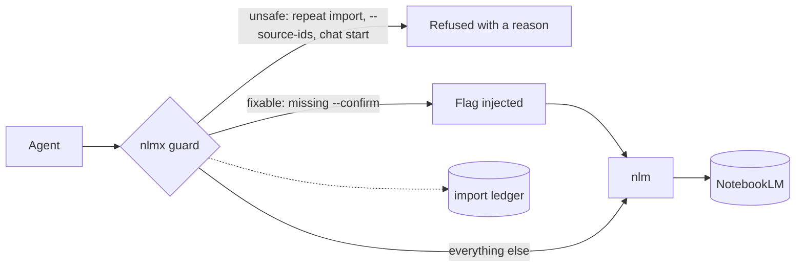
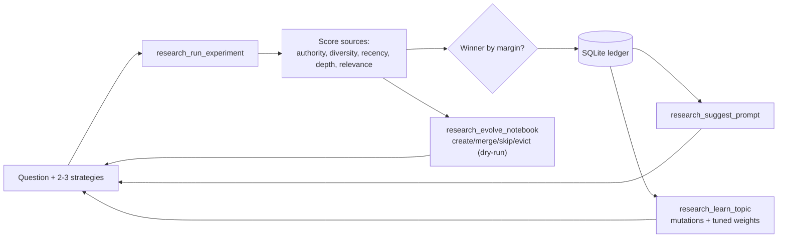

# NoteLab 🧪

**A self-improving research lab for your coding agent, on top of Google NotebookLM — it scores whether your research is any good, guards your notebooks from silent corruption, and turns a pile of sources into an action plan.**

[](https://github.com/werister/notelab/actions/workflows/tests.yml)


Most "NotebookLM MCP" tools are a remote control: create notebook, add source, query. NoteLab is the
layer *above* it — it judges whether the sources are any good, and helps your agent act on them.

## Highlights

- 🧪 **A scored, diverse research library.** Pulls papers, docs, repos, videos and discussion into a notebook and scores the set — authority, **kind-diversity**, recency, depth, relevance — so "did I read widely enough?" is a number, not a feeling. Deterministic, **zero model tokens**. → [quality model](docs/DESIGN.md)
- 🎚️ **You decide what counts as good.** Weight papers over forums, forums over papers, or anything per use-case with `kind_weights` — no fixed ranking baked in. → [the principle](docs/DESIGN-PRINCIPLE-user-owns-value.md) · [config](docs/CONFIG.md)
- 🧭 **From a score to an action.** `research_export` turns the scored library into a report with a verdict, the gaps, and numbered **next actions** — safe to hand a human or paste into a PR.
- 🛡️ **A guard (`nlmx`) that can't be talked around.** Refuses the NotebookLM commands that silently corrupt a library (duplicate imports, broken `--source-ids`, `chat start`). Live agents from two model families were stopped **6/6**. → [the guard & its evidence](docs/NLMX.md)
- 🔁 **A loop that learns.** A/B-test research prompts on measured source quality, store the winner per topic, replay it next time. → [how it works](#how-it-works)
- 🔎 **A versioned code index** (bonus, no account needed). Exact `where is X` / `who calls X` / `what subclasses X` / `what changed since v1.2`, with real `repo@commit/path:line` source — and every version is kept.
- 📦 **Stdlib-only engine.** The whole scorer/loop/MCP server installs and tests with **zero third-party dependencies**; you can read the whole thing.

## Install

Python 3.10+ (CI covers 3.10 through 3.14). Install into a virtualenv:

```bash
python3 -m venv .venv && . .venv/bin/activate   # or: uv venv && . .venv/bin/activate
pip install -e .                                 # stdlib-only, no third-party deps
```
On a very new interpreter whose stdlib `venv` can't bootstrap pip (seen with some
Homebrew Python 3.14 builds: `python3 -m venv` fails in `ensurepip`), use
[uv](https://docs.astral.sh/uv/) instead — it creates the venv and installs without
relying on `ensurepip`:
```bash
uv venv && uv pip install -e .
```
Wire it into any MCP client:
```json
{ "mcpServers": { "nlm-research": { "command": "nlm-research-mcp" } } }
```
Prefer the official MCP SDK? `pip install -e ".[mcp]"` then `nlm-research-mcp --sdk`.

**Live NotebookLM research** additionally needs the upstream [`nlm`](https://github.com/jacob-bd/notebooklm-mcp-cli) CLI (it owns Google auth); everything else — scorer, A/B, planner, evals, catalog, code index — runs without an account.
```bash
pipx install notebooklm-mcp-cli && nlm login && nlm login --check
```
Install the agent skills (Claude Code / Cursor / Copilot): `scripts/install-skills.sh <claude|cursor|all> --with-guard`.

## Try it in 60 seconds (no account)

```bash
git clone https://github.com/werister/notelab && cd notelab
python3 -m venv .venv && . .venv/bin/activate   # or: uv venv && . .venv/bin/activate
pip install -e ".[dev]"
scripts/verify.sh            # offline tests + demo + guard refusals, one checklist
```
```
NoteLab verify
  PASS  engine imports (stdlib only)      PASS  code index: exact lookup + versions
  PASS  offline test suite                PASS  guard refuses --source-ids
  PASS  self-improving loop demo          PASS  guard refuses chat start
  PASS  skills present with frontmatter
All good.
```

## Pick your path

| I want to… | Run | Needs |
|---|---|---|
| See the self-improving loop work | `python examples/self_improving_loop.py` | Python only |
| Ask exact questions about code, across versions | `python3 -m notelab.codeindex index <repo>` then `find` / `diff` | Python only |
| Research a topic and score the source mix | *"research-loop skill: A/B two prompts on `<question>`, tell me the winner + margin"* | `nlm` login |
| Get an action plan from a notebook | `research_export(notebook_id, question)` | `nlm` login |
| Stop an agent wrecking a notebook | `scripts/install-skills.sh claude --with-guard` | `nlm` login |
| Improve a prompt/skill with evidence | `skills/skill-evolution/scripts/evolve.py --init` | an agent CLI |

## What goes wrong without it

Observed failures, each reproduced on isolated notebooks and checked against ground truth
(`nlm source list`) — evidence in [docs/NLMX.md](docs/NLMX.md).

| The failure | What the agent sees | What NoteLab does |
|---|---|---|
| `research import` run twice **duplicates every source** | the same "✓ Imported N sources" both times | `nlmx` keeps a ledger and refuses the repeat unless `--force` |
| `--source-ids` **deselects every source** | `sources_used: []` | `nlmx` refuses and names the working alternative |
| generation commands silently no-op without `--confirm` | nothing | `nlmx` injects the flag |
| `chat start` opens a REPL an agent can't drive | a hang | `nlmx` refuses, points to one-shot `query` |
| research prompts tuned by vibes | "this one felt better" | A/B on measured source quality, winner stored |
| notebooks fill with duplicates / stale sources | quality decays quietly | `research_evolve_notebook` plans create/merge/skip/evict (dry-run first) |

## You decide what counts as a good source

NoteLab has **no fixed opinion** that papers beat forums or that diversity is always best — *you*
own what you value, and it changes with the task. Say so with `kind_weights`:

```python
# literature review: papers matter, forums/videos shouldn't move the score
{"kind_weights": {"paper": 1.0, "docs": 0.8, "discussion": 0.0, "video": 0.0}}
# learning a tool: walkthroughs and community threads matter most
{"kind_weights": {"discussion": 1.0, "video": 0.9, "paper": 0.3}}
```
`0.0` means "ignore this kind." Presets **`academic`** and **`forum_first`** ship opposite values —
the same sources score differently under each, because "good" is your call. Full detail:
[docs/CONFIG.md](docs/CONFIG.md) · [the design principle](docs/DESIGN-PRINCIPLE-user-owns-value.md).

## From a score to an action

A number isn't a decision. `research_export(notebook_id, question)` renders the scored library as an
actionable report (`fmt`: `markdown` default · `json` · `csv`):

```markdown
# Research report: how to build a rag application with vector databases
**Overall source quality:** 0.4468  ·  verdict: thin
**Sources:** 4  ·  kind-diversity 0.25

## What stands out
- 1 source(s) look like blocked bot-wall / sign-in shells (video) — no real content.
- Question terms not covered by any source: application, build, databases, vector.

## Next actions
1. Run research_fix_videos(notebook_id, apply=true) to re-add blocked videos natively…
2. Research again targeting the uncovered terms…
3. Assessment says 'thin' — gather more / higher-quality sources first.
```

## How it works

**The guard** — where `nlmx` sits between the agent and `nlm`:


**The loop** — how each run improves the next:


Scores measure **source data quality, not answer quality** — a 0.9 arm found good sources; you still
read them. A margin under 0.05 is a tie, and the tool says so. Design & quality model:
[docs/DESIGN.md](docs/DESIGN.md).

## Evaluations

Claims here are backed by checks you can rerun — full detail and commands in
[docs/EVALUATIONS.md](docs/EVALUATIONS.md), a hands-on run in
[docs/EVAL-REPORT-2026-10-08.md](docs/EVAL-REPORT-2026-10-08.md), and real-NotebookLM results in
[docs/LIVE-FINDINGS-2026-10-08.md](docs/LIVE-FINDINGS-2026-10-08.md).

| What is checked | Result |
|---|---|
| The guard stops a **real agent**, not just a unit test | **6/6** across two model families (opencode 3/3, claude 3/3) |
| Source scoring is auditable | every composite decomposes into its five signals; weights are config |
| Skills improve only when they **measurably** win | recorded duels held (tie → no promotion); the gate refuses unearned wins |
| Live NotebookLM path | verified end-to-end: auth, real Deep Research, the guard refusing a **real** duplicate import, `research_fix_videos` turning a 21k bot-wall shell into a 144k transcript |
| The whole package | **the offline suite passes**, 2 optional/env-gated tests skip; CI on Python 3.10 through 3.14 |

**What it does not do.** `nlmx` guards the behaviours above, not all of NotebookLM; everything else passes
through to `nlm`. Source-quality scores say nothing about whether an answer is *correct*. It does not handle
your Google credentials — `nlm` does. Report vulnerabilities privately: [SECURITY.md](SECURITY.md).

## The skills

Four agent skills in `skills/` — install with `scripts/install-skills.sh <claude|cursor|all> [--with-guard] [--link]`:

- **research-loop** — research *through* NoteLab: A/B prompts, score, curate, record wins. [SKILL.md](skills/research-loop/SKILL.md)
- **skill-evolution** — make a prompt measurably better via champion/challenger duels on a fixed battery. [SKILL.md](skills/skill-evolution/SKILL.md)
- **code-questions** — targeted, versioned code lookups (no account needed). [SKILL.md](skills/code-questions/SKILL.md)
- **nlm-skill** — operate NotebookLM safely, routed through `nlmx`. [SKILL.md](skills/nlm-skill/SKILL.md)

## MCP tools (20)

<details><summary>Full tool table</summary>

| Tool | What it does |
|---|---|
| `research_run_experiment(question, strategies, weights?)` | A/B several prompt strategies; score each run's sources; rank; record to ledger |
| `research_score_notebook(notebook_id, question?, weights?, semantic_expansions?)` | Score an existing notebook's sources; returns per-signal scores + `type_mix`/`type_diversity`. `weights` = a preset (`project_kickstart`/`academic`/`forum_first`/`lit_review`/`news`/`docs`/`balanced`) or a dict incl. `kind_weights` |
| `research_export(notebook_id, question?, weights?, fmt?, deep?)` | Actionable report: verdict, source-kind mix, problems, numbered next actions. `fmt`: `markdown`/`json`/`csv` |
| `research_assess(notebook_id, question?, mode?, weights?, use_laya?, semantic_expansions?)` | `fast` good/thin/bloated + coverage gaps, or `deep` ablation + redundant pairs + greedy prune |
| `research_evolve_notebook(notebook_id, question?, keep_budget?, quality_floor?, apply?)` | Plan create/merge/skip/evict over a notebook's sources; evictions stay behind the confirm gate |
| `research_fix_videos(notebook_id, apply?, remove_junk?)` | Repair YouTube sources imported as bot-wall pages: plan, or re-add natively so the real transcript is used |
| `research_history(experiment_id?, limit?)` | Browse the experiment ledger, or fetch one full result |
| `research_suggest_prompt(question)` | Reuse the winning prompt from a prior experiment on the same question |
| `research_learn_topic(question, explore?)` | Turn a topic's history into prompt mutations + a tuned weight profile |
| `research_eval_skill(strategy_name)` | Is a strategy improving or regressing? OLS-slope trend + raw series |
| `research_spar(question, prompt, families?)` | Run one prompt through several model-family CLIs over a shared corpus; score + attribute |
| `research_family_leaderboard()` | Which model family finds the best sources for which kind of question |
| `research_adversarial_run(prompt, runners?, timeout?)` | Run a prompt through installed agent CLIs; missing ones skipped, not failed |
| `research_ingest_codebase(repo, notebook_id?, title?, max_files?, mode?, max_sources?)` | Add a repo to a notebook: `digest` (summary) or `files` (real source) |
| `catalog_sync(notebook_ids?)` / `catalog_search(query, limit?)` | Index notebooks+sources locally; full-text "what do we already know about X" |
| `code_index(repo, name?, version?)` | Index a repo locally as a kept, versioned snapshot (default label: git commit) |
| `code_find(query, kind?, repo?, version?, limit?)` | Exact lookup: `def` (with source), `callers`, `subclasses`, `text`, `any` |
| `code_versions(repo?)` / `code_diff(repo, old, new)` | List kept versions; diff files + functions added/removed/changed |

</details>

## Docs

[DESIGN](docs/DESIGN.md) · [CONFIG](docs/CONFIG.md) weights & `kind_weights` ·
[DESIGN PRINCIPLE](docs/DESIGN-PRINCIPLE-user-owns-value.md) you own what you value ·
[NLMX](docs/NLMX.md) the guard & its evidence · [EVALUATIONS](docs/EVALUATIONS.md) ·
[LIVE FINDINGS](docs/LIVE-FINDINGS-2026-10-08.md) · [GAP ANALYSIS](docs/GAP-ANALYSIS-2026-vs-SOTA.md) what's next ·
[FIELD-NOTES](docs/FIELD-NOTES.md) · [CHANGELOG](CHANGELOG.md) · [CONTRIBUTING](CONTRIBUTING.md) · [SCOPE](SCOPE.md)

## Contributing

Bug reports with an observed failure are the most useful kind: what you ran, what happened, what you
expected. See [SCOPE.md](SCOPE.md) for the bar and [CONTRIBUTING.md](CONTRIBUTING.md) for setup. MIT licensed.
